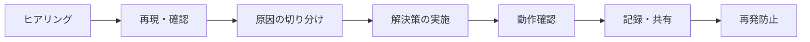
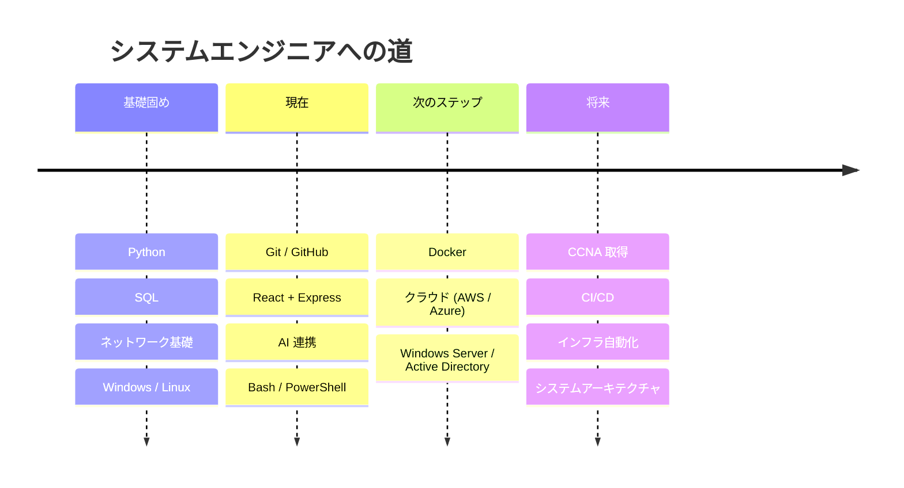
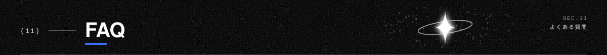
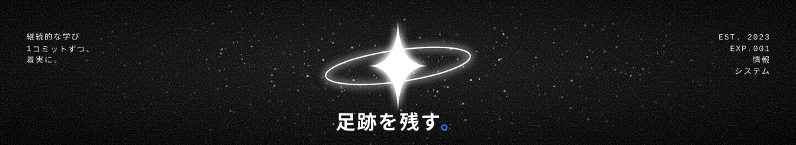

<!--
  GitHub プロフィール README · ホセ・ルイス・オビエド・カマチョ
  スタイル：モノクロ・エディトリアル、粒子感、等幅ラベル、星と軌道、アクセントは青のみ。
-->

<p align="center">
  
</p>

<p align="center">
  <code>EST. 2023</code>&nbsp;
  <code>システム工学</code>&nbsp;
  <code>ネットワーク</code>&nbsp;
  <code>インフラ</code>&nbsp;
  <code>技術サポート</code>&nbsp;
  <code>インターン／初就職 募集中</code>
</p>

<br/>

## 目次

| No. | セクション | 内容 |
| :---: | :--- | :--- |
| `01` | プロフィール | 自己紹介と基本情報 |
| `02` | 技術スタック | 言語・OS・ツール一覧 |
| `03` | スキル | システムエンジニアとしての分野別スキルマップ |
| `04` | プロジェクト | これまでに取り組んだ実績 |
| `05` | 学歴 | 教育のあゆみ |
| `06` | ソフトスキル | 仕事の進め方と人柄 |
| `07` | 仕事の流儀 | 問題解決のプロセス |
| `08` | ロードマップ | 今後の成長計画 |
| `09` | 現在 | いま進めていること |
| `10` | 言語 | 話せる言語 |
| `11` | FAQ | よくある質問 |
| `12` | 連絡先 | つながりましょう |

<br/>


<table>
<tr>
<td width="62%" valign="top">

### こんにちは、ホセ・ルイスです。

**情報システム技術** を専攻している学生です。

**ネットワーク、プログラミング、OS の管理、そしてユーザーサポート** を中心に学んでいます。
「なぜ壊れたのか」を理解し、きちんと動く状態に戻すことにやりがいを感じます。
吸収が早く、まだ知らないことにも臆せず挑戦します。

現在、**技術サポート**、**システム分析**、**IT インフラ運用**、
**テクノロジーソリューション開発** の分野で、
**最初の実務経験** を積める場所を探しています。

> 「仕組みを理解すれば、どんな障害も解ける問題になる。」

</td>
<td width="38%" valign="top">

```txt
アイデンティティ..... 常に前進
役割............... 学生
目標............... システムエンジニア
専攻............... 情報システム技術
状態............... 学習中
得意分野........... サポート / ネットワーク
関心領域........... インフラ / クラウド / 自動化
働き方............. リモート・ハイブリッド・出社
```

</td>
</tr>
</table>

### ひと目でわかる私

```txt
┌──────────────────────────────────────────────────────────────┐
│  ▸ 2022年から周囲の人々の PC・ネットワークのトラブルを解決      │
│  ▸ Windows / Linux のインストール・設定・診断を日常的に実施     │
│  ▸ Python と SQL によるロジック設計とデータ管理の基礎           │
│  ▸ LAN・TCP/IP・ルーティングの基礎知識                         │
│  ▸ React + Express + Gemini で AI 搭載ポートフォリオを開発中    │
│  ▸ 専門用語を使わずに技術をわかりやすく説明できる               │
└──────────────────────────────────────────────────────────────┘
```


> **凡例** &nbsp;— &nbsp;`●●●●○` 実践レベル &nbsp;·&nbsp; `●●●○○` 基礎 &nbsp;·&nbsp; `●●○○○` 入門 &nbsp;·&nbsp; `●○○○○` 学習中

### プログラミング言語

| 言語 | 用途 | レベル |
| :--- | :--- | :---: |
| `Python` | 構造化プログラミング、スクリプト、自動化、オブジェクト指向 | `●●●○○` |
| `SQL` | クエリ、リレーショナルモデリング、正規化 | `●●●○○` |
| `JavaScript` | Web フロントエンド、Node.js | `●●○○○` |
| `HTML / CSS` | Web ページのマークアップとスタイリング | `●●●○○` |
| `Bash` | Linux のシェルスクリプト、自動化 | `●●○○○` |
| `PowerShell` | Windows 管理タスクの自動化 | `●●○○○` |
| `Java` | オブジェクト指向の基礎 | `●○○○○` |

### オペレーティングシステム

| OS | できること | レベル |
| :--- | :--- | :---: |
| `Windows 10 / 11` | クリーンインストール、ドライバ、レジストリ、ユーザー管理、復旧 | `●●●●○` |
| `Windows Server` | Active Directory、DNS、DHCP、グループポリシーの基礎 | `●○○○○` |
| `Ubuntu / Debian` | パッケージ管理、権限、サービス、SSH | `●●○○○` |
| `Linux 全般` | ファイルシステム、プロセス管理、cron、ログ確認 | `●●○○○` |

### ネットワーク

| 分野 | 内容 | レベル |
| :--- | :--- | :---: |
| `LAN / WLAN` | 家庭・小規模オフィスのネットワーク構築 | `●●●○○` |
| `TCP/IP` | OSI 参照モデル、IPv4 アドレッシング、サブネット化 | `●●●○○` |
| `ルーティング` | 静的ルーティング、動的ルーティングの基本概念 | `●●○○○` |
| `サービス` | DNS、DHCP、NAT、VPN の仕組み | `●●○○○` |
| `診断コマンド` | ping、tracert、ipconfig、nslookup、netstat、Wireshark | `●●●○○` |
| `Cisco Packet Tracer` | ネットワークトポロジーのシミュレーション | `●●○○○` |

### データベース

| 技術 | 内容 | レベル |
| :--- | :--- | :---: |
| `MySQL` | テーブル設計、JOIN、インデックス | `●●●○○` |
| `PostgreSQL` | 基本的なクエリと管理 | `●●○○○` |
| `SQLite` | 小規模アプリでのローカル保存 | `●●○○○` |
| `ER 図` | 要件からのデータモデリング | `●●●○○` |

### Web 開発（学習中）

| 技術 | 内容 | レベル |
| :--- | :--- | :---: |
| `React` | コンポーネント、状態管理、Hooks | `●○○○○` |
| `Vite` | 開発環境とビルド | `●○○○○` |
| `Node.js / Express` | REST API、ミドルウェア | `●○○○○` |
| `AI 連携 (Gemini)` | LLM API の組み込み、プロンプト設計 | `●○○○○` |

### ツール・プラットフォーム

| カテゴリ | ツール |
| :--- | :--- |
| `バージョン管理` | Git、GitHub、ブランチ運用、プルリクエスト |
| `エディタ / IDE` | Visual Studio Code、PyCharm |
| `仮想化` | VirtualBox、VMware、Hyper-V |
| `コンテナ（学習中）` | Docker の基礎 |
| `クラウド` | Google Drive、Google Workspace、クラウドストレージ全般 |
| `オフィス` | Excel（関数・表・グラフ）、Word、PowerPoint |
| `診断ツール` | タスクマネージャー、イベントビューアー、CrystalDiskInfo、HWMonitor、MemTest86 |
| `リモートサポート` | AnyDesk、TeamViewer、リモートデスクトップ |
| `コミュニケーション` | Discord、Slack、Microsoft Teams、Google Meet |


<details open>
<summary><b>技術サポート・ヘルプデスク</b></summary>

<br/>

- ハードウェアの組み立て、部品交換（RAM・SSD・電源・ファン）
- OS のクリーンインストールとイメージからの復元
- ドライバ・周辺機器（プリンター、スキャナー、Web カメラ）の設定
- ソフトウェアのインストール、ライセンス管理、アップデート
- 起動しない PC、ブルースクリーン、動作が遅い PC の診断と修理
- データのバックアップと復旧
- ウイルス・マルウェアの除去と予防策の導入
- 一次対応（L1）から二次対応（L2）へのエスカレーション手順の理解
- チケット管理の考え方（受付 → 分類 → 対応 → 記録 → クローズ）

</details>

<details open>
<summary><b>ネットワーク管理</b></summary>

<br/>

- ルーター・アクセスポイント・スイッチの初期設定
- IP アドレス設計とサブネットマスクの計算
- DHCP の範囲設定と固定 IP の割り当て
- Wi-Fi のセキュリティ設定（WPA2 / WPA3、SSID 管理）
- 接続障害の切り分け（物理層 → ネットワーク層 → アプリケーション層）
- LAN ケーブルの作成と配線（T568A / T568B）
- ポート開放・ファイアウォールの基本ルール
- ネットワーク構成図の作成とドキュメント化

</details>

<details open>
<summary><b>システム管理（Windows / Linux）</b></summary>

<br/>

- ユーザーアカウント、グループ、アクセス権限の管理
- サービスの起動・停止・自動起動設定
- ディスクのパーティション管理とフォーマット
- ログの確認とトラブルの原因調査
- タスクスケジューラ / cron による定期処理の自動化
- SSH によるリモート管理
- システムのパフォーマンス監視とリソース最適化
- Windows Update / apt による更新管理

</details>

<details open>
<summary><b>システム分析・設計</b></summary>

<br/>

- 要件定義（ヒアリング → 機能要件・非機能要件の整理）
- ユースケース図、クラス図、シーケンス図（UML）
- データフロー図（DFD）とプロセスモデリング
- ER 図によるデータベース設計と正規化（第1〜第3正規形）
- ソフトウェア開発ライフサイクル（SDLC）の理解
- アジャイル / スクラムの基本的な考え方
- 技術ドキュメント・マニュアルの作成

</details>

<details open>
<summary><b>情報セキュリティの基礎</b></summary>

<br/>

- 強固なパスワードポリシーと多要素認証（MFA）の導入
- 最小権限の原則
- フィッシング・ソーシャルエンジニアリングへの注意喚起
- バックアップ戦略（3-2-1 ルール）
- ファイアウォールとウイルス対策ソフトの設定
- 情報の機密性・完全性・可用性（CIA）の理解

</details>

<details open>
<summary><b>データ管理</b></summary>

<br/>

- SQL によるデータの抽出・集計・更新
- Excel を使ったデータ整理、関数、ピボットテーブル、グラフ作成
- データのクレンジングと整合性チェック
- 小規模システム向けのデータベース設計

</details>

<details open>
<summary><b>自動化・スクリプト</b></summary>

<br/>

- Python による繰り返し作業の自動化（ファイル整理、レポート作成）
- PowerShell による Windows 管理作業の効率化
- Bash スクリプトによる Linux の定型処理
- 作業手順をスクリプト化して、ミスと時間を削減

</details>

### スキルマップ

```txt
技術サポート        ████████████████░░░░  80%
Windows 管理        ████████████████░░░░  80%
ネットワーク基礎    ████████████░░░░░░░░  60%
Python              ████████████░░░░░░░░  60%
SQL / データベース  ████████████░░░░░░░░  60%
システム分析        ████████████░░░░░░░░  60%
Linux               ██████████░░░░░░░░░░  50%
Git / GitHub        ██████████░░░░░░░░░░  50%
情報セキュリティ    ██████████░░░░░░░░░░  50%
Web 開発            ██████░░░░░░░░░░░░░░  30%
クラウド / Docker   ████░░░░░░░░░░░░░░░░  20%
```


<table>
<tr>
<td width="50%" valign="top">

**`EXP.001` · AI 搭載パーソナルポートフォリオ**<br/>
<sub>`2026` · `開発中`</sub>

**AI アシスタント** を搭載した Web ポートフォリオ。
私の履歴書に記載された実際の情報だけを使って、
プロフィールに関する質問に答えます。

**担当内容**
- フロントエンドのコンポーネント設計
- Express による API サーバー構築
- Gemini API との連携とプロンプト設計
- 回答を履歴書の事実に限定する仕組み

`React` `Vite` `Express` `Gemini`

</td>
<td width="50%" valign="top">

**`EXP.002` · 在庫管理システム**<br/>
<sub>`2024` · `大学プロジェクト`</sub>

在庫の登録と検索を行う **Python** 製の
コンソールアプリケーション。

**担当内容**
- 構造化ロジックの設計
- ファイルによるデータの永続化
- オブジェクト指向プログラミングの基礎を適用
- 入力値の検証とエラー処理

`Python` `オブジェクト指向` `ファイル操作`

</td>
</tr>
<tr>
<td width="50%" valign="top">

**`EXP.003` · Discord サーバーの運営管理**<br/>
<sub>`2024` · `カスタマーサポート`</sub>

カスタマーサポートを目的としたサーバーの運営。

**担当内容**
- ユーザーへのサポート対応
- チャンネル構成とロール権限の設計
- 問い合わせの追跡と管理
- トラブルの迅速な解決

`サポート` `コミュニティ` `組織運営`

</td>
<td width="50%" valign="top">

**`EXP.004` · 非公式の技術サポート**<br/>
<sub>`2022 — 現在` · `コミュニティ`</sub>

身近な人々のために Windows・Linux のインストール、
家庭用ネットワークの設定、ハードウェア・ソフトウェアの
障害対応を行っています。

ここで **診断する力** と、**専門用語を使わずに説明する力** を身につけました。

`Windows` `Linux` `ネットワーク` `ハードウェア`

</td>
</tr>
</table>

### プロジェクトで得た学び

| プロジェクト | 一番の学び |
| :--- | :--- |
| `EXP.001` | AI は「何を答えないか」を設計することが信頼につながる |
| `EXP.002` | 最初にデータ構造を決めると、後の実装がずっと楽になる |
| `EXP.003` | 良いサポートは、技術よりもまず「聞く姿勢」から始まる |
| `EXP.004` | 原因を一つずつ切り分ければ、どんな障害も解決できる |


```txt
2023 — 現在   情報システム技術（在学中）
              主な科目：プログラミング、データベース、ネットワーク、
                       OS 管理、システム分析・設計、情報セキュリティ

2022          技術系高等学校 卒業
```

### 主な履修分野

| 分野 | 学んだ内容 |
| :--- | :--- |
| `アルゴリズムとロジック` | フローチャート、擬似コード、構造化プログラミング |
| `データベース` | リレーショナルモデル、SQL、正規化 |
| `ネットワーク` | OSI モデル、TCP/IP、LAN 設計 |
| `オペレーティングシステム` | プロセス、メモリ、ファイルシステム |
| `システム分析` | 要件定義、UML、SDLC |
| `ソフトウェア工学` | 開発手法、テスト、ドキュメント |
| `情報セキュリティ` | リスク管理、アクセス制御 |


| スキル | 具体的には |
| :--- | :--- |
| `問題解決力` | 障害の原因を論理的に切り分け、根本から解決する |
| `コミュニケーション` | 技術的な内容を、誰にでもわかる言葉で説明できる |
| `学習意欲` | 新しい技術を自分から調べ、すぐに試す |
| `チームワーク` | 知識を共有し、周囲と協力して目標を達成する |
| `傾聴力` | ユーザーの困りごとを最後まで聞き、本当の課題を見つける |
| `責任感` | 引き受けた作業は最後までやり遂げる |
| `時間管理` | 優先順位をつけ、締め切りを守る |
| `冷静さ` | トラブル時でも落ち着いて対応する |


トラブル対応では、次のプロセスを大切にしています。



```txt
1. 聞く        ── 何が起きたのか、いつからか、何を変えたのかを確認する
2. 再現する    ── 実際に問題を目で見て、事実を集める
3. 切り分ける  ── ハードか、ソフトか、ネットワークか、ユーザー操作か
4. 直す        ── 最小限の変更で、安全に解決する
5. 確かめる    ── 本当に直ったかをユーザーと一緒に確認する
6. 残す        ── 手順と原因を記録し、次に活かす
7. 防ぐ        ── 同じ問題が起きないように仕組みを改善する
```




### 目標としている資格

| 資格 | 分野 | 状況 |
| :--- | :--- | :---: |
| `CompTIA A+` | ハードウェア / 技術サポート | `準備中` |
| `Cisco CCNA` | ネットワーク | `予定` |
| `CompTIA Network+` | ネットワーク | `予定` |
| `AWS Cloud Practitioner` | クラウド | `予定` |
| `Microsoft Azure Fundamentals (AZ-900)` | クラウド | `予定` |
| `Linux Essentials (LPI)` | Linux | `予定` |


```txt
[ 進行中 ]  AI アシスタント付きポートフォリオ（React + Express + Gemini）を仕上げ中
[ 継続中 ]  演習と小さなプロジェクトで Python と SQL を強化中
[ 継続中 ]  Git と GitHub を練習中 ── 1 コミットずつ着実に
[ 継続中 ]  Linux のコマンドとシェルスクリプトを毎日練習
[ 継続中 ]  Cisco Packet Tracer でネットワーク構成をシミュレーション
[ 学習中 ]  Docker とクラウドの基礎
[ 募集中 ]  技術サポート、システム分析、開発分野でのインターン／初就職
```

### 今年の目標

- [x] AI 搭載ポートフォリオの開発に着手する
- [x] GitHub プロフィールを整える
- [ ] 公開リポジトリを 10 個以上にする
- [ ] 初めての IT 資格を取得する
- [ ] 初めての実務経験を得る


| 言語 | レベル |
| :--- | :--- |
| `スペイン語` | ネイティブ |
| `英語` | 技術文書の読解が可能 |



<details>
<summary><b>どんな仕事を探していますか？</b></summary>

<br/>

技術サポート、ヘルプデスク、システム分析、IT インフラ運用、
またはソフトウェア開発のアシスタント職です。インターンも大歓迎です。

</details>

<details>
<summary><b>リモートで働けますか？</b></summary>

<br/>

はい。リモート、ハイブリッド、出社のいずれにも対応できます。

</details>

<details>
<summary><b>一番の強みは何ですか？</b></summary>

<br/>

問題の原因を冷静に切り分ける力と、それを誰にでもわかる言葉で説明できることです。

</details>

<details>
<summary><b>経験が少ないことをどう補いますか？</b></summary>

<br/>

学ぶスピードと継続力です。わからないことは調べ、試し、記録し、次に活かします。
2022年から続けている非公式の技術サポートが、その証拠です。

</details>


| チャネル | リンク |
| :--- | :--- |
| `GitHub` | [github.com/Layoverv](https://github.com/Layoverv) |

> インターン、プロジェクト、学びの共有など、お気軽にご連絡ください。

<p align="center">
  
</p>
