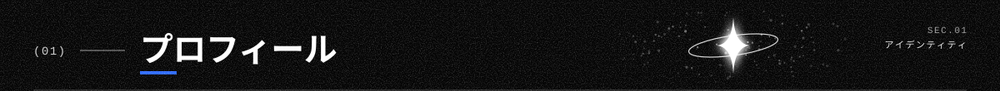
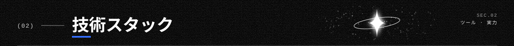

<!--
  README de perfil · José Luis Oviedo Camacho
  Estética: editorial B/N, grano, etiquetas monoespaciadas, estrella + órbita, un solo acento azul.
  Reemplaza todo lo que diga TU_USUARIO / TU_LINKEDIN / TU_PORTAFOLIO antes de publicar.
-->

<p align="center">
  
</p>

<p align="center">
  <code>EST. 2023</code>&nbsp;
  <code>SEM.07</code>&nbsp;
  <code>CALI, CO</code>&nbsp;
  <code>SISTEMAS · REDES · SOPORTE</code>&nbsp;
  <code>🔵 ABIERTO A PRÁCTICAS / PRIMER EMPLEO</code>
</p>

<br/>



<table>
<tr>
<td width="62%" valign="top">

### Hola, soy José Luis.

Estudiante de **7.º semestre de Tecnología en Sistemas de Información** en la
**Institución Universitaria Antonio José Camacho (UNIAJC)**, en Cali.

Me formo en **redes, programación, administración de sistemas operativos y
atención al usuario**. Me gusta entender por qué algo falla y dejarlo
funcionando. Aprendo rápido y sin miedo a lo que todavía no sé.

Busco mi **primera experiencia profesional** en **soporte técnico**,
**análisis de sistemas** o **desarrollo de soluciones tecnológicas**.

</td>
<td width="38%" valign="top">

```txt
IDENTIDAD.......... EN MOVIMIENTO
ROL................ ESTUDIANTE
PROGRAMA........... SISTEMAS DE INFO.
SEMESTRE........... 07
BASE............... CALI, CO
ESTADO............. APRENDIENDO
ENFOQUE............ SOPORTE / DATOS
```

</td>
</tr>
</table>



<p>
  
  
  
  
  
  
  
  
  
</p>

<sub>Negro = base del CV · <b>Azul</b> = lo que estoy aprendiendo ahora en mi portafolio.</sub>

| ÁREA | QUÉ HAGO | NIVEL |
| :--- | :--- | :--- |
| `PROGRAMACIÓN` | Python, lógica de programación estructurada | Fundamentos |
| `BASES DE DATOS` | SQL y modelado de datos relacionales | Fundamentos |
| `SISTEMAS OPERATIVOS` | Windows (administración y configuración) · Linux | Windows: práctica frecuente · Linux: básico |
| `REDES` | Redes LAN, TCP/IP, fundamentos de routing | Fundamentos |
| `SOPORTE TÉCNICO` | Instalación, configuración y diagnóstico de hardware y software | En práctica desde 2022 |
| `HERRAMIENTAS` | Excel, Word, PowerPoint, Google Workspace, Google Drive, herramientas cloud | Uso diario |
| `CONTROL DE VERSIONES` | Git y GitHub | Básico |
| `WEB (APRENDIENDO)` | React, Express, integración con IA (Gemini) | En aprendizaje |


<table>
<tr>
<td width="50%" valign="top">

**`EXP.001` · PORTAFOLIO PERSONAL CON IA**<br/>
<sub>`2026` · `EN DESARROLLO`</sub>

Mi portafolio web con un **asistente de IA** que responde preguntas sobre mi
perfil usando solo la información real de mi hoja de vida.

`React` `Vite` `Express` `Gemini`

<!-- Cambia el enlace cuando subas el repositorio -->
[→ Ver repositorio](https://github.com/TU_USUARIO/Portafolio-personal)

</td>
<td width="50%" valign="top">

**`EXP.002` · SISTEMA DE GESTIÓN DE INVENTARIO**<br/>
<sub>`2024` · `PROYECTO UNIVERSITARIO`</sub>

Aplicación de consola en **Python** para registrar y consultar inventarios.
Lógica estructurada, manejo de archivos y fundamentos de programación
orientada a objetos.

`Python` `POO` `Archivos`

</td>
</tr>
<tr>
<td width="50%" valign="top">

**`EXP.003` · ADMINISTRACIÓN DE SERVIDOR DE DISCORD**<br/>
<sub>`2024` · `ATENCIÓN AL CLIENTE`</sub>

Gestión de un servidor enfocado en atención al cliente: soporte a usuarios,
organización de canales, seguimiento de solicitudes y resolución de
problemas.

`Soporte` `Comunidad` `Organización`

</td>
<td width="50%" valign="top">

**`EXP.004` · SOPORTE TÉCNICO INFORMAL**<br/>
<sub>`2022 — HOY` · `COMUNIDAD`</sub>

Instalación de Windows y Linux, configuración de redes domésticas y
solución de fallas de hardware y software para personas de mi entorno.
Aquí aprendí a diagnosticar y a explicar sin tecnicismos.

`Windows` `Linux` `Redes` `Hardware`

</td>
</tr>
</table>


```txt
2023 — HOY   TECNOLOGÍA EN SISTEMAS DE INFORMACIÓN · 7.º SEMESTRE (EN CURSO)
             Institución Universitaria Antonio José Camacho (UNIAJC) · Cali

2022         BACHILLER TÉCNICO
             Institución Educativa Leonor Lourido de Velasco · Yumbo
```


- 🔵 &nbsp;Terminando mi **portafolio con asistente de IA** (React + Express + Gemini).
- ◻️ &nbsp;Reforzando **Python y SQL** con ejercicios y proyectos pequeños.
- ◻️ &nbsp;Practicando **Git y GitHub**: un commit a la vez.
- ◻️ &nbsp;Buscando **prácticas o primer empleo** en soporte técnico, análisis de sistemas o desarrollo.


<p>
  <a href="https://www.linkedin.com/in/TU_LINKEDIN"></a>
  <a href="https://TU_PORTAFOLIO"></a>
  <a href="https://github.com/TU_USUARIO"></a>
</p>

<!--
  OPCIONAL · Estadísticas de GitHub con la misma paleta (negro + azul).
  Quita los comentarios cuando tengas algunos repositorios públicos:

<p>
  
  
</p>
-->

<p align="center">
  
</p>
